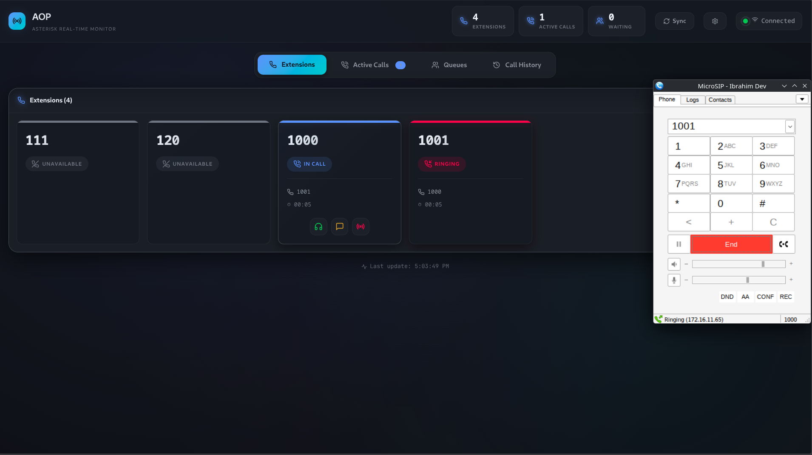
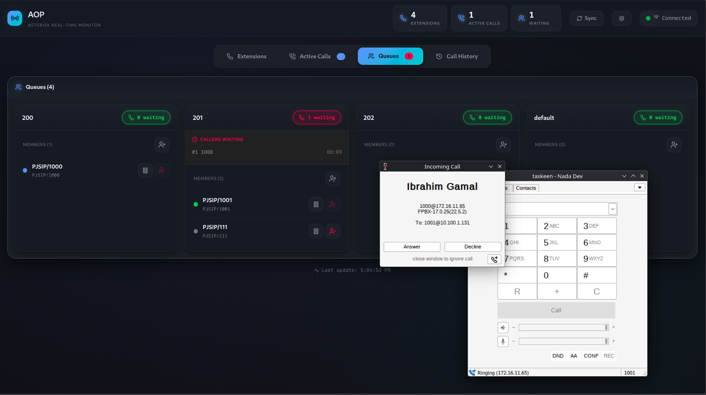
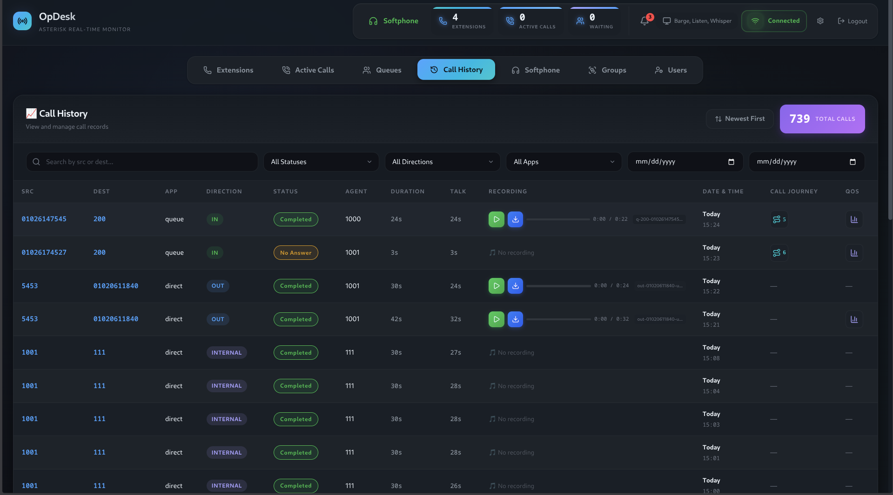
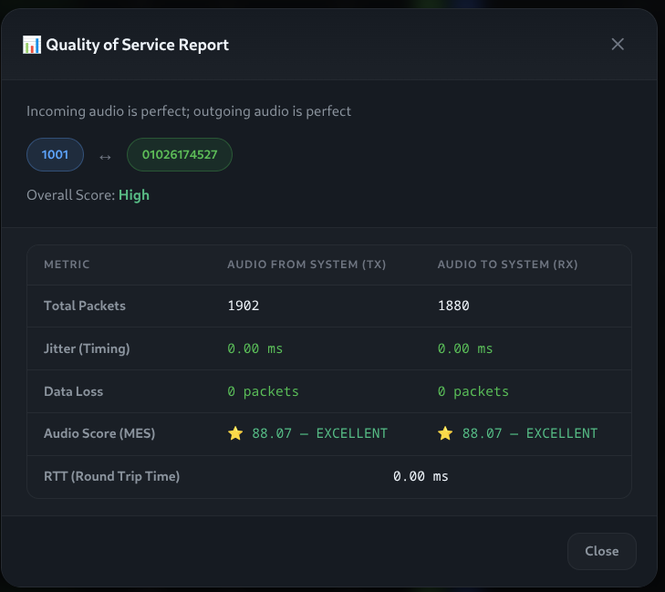
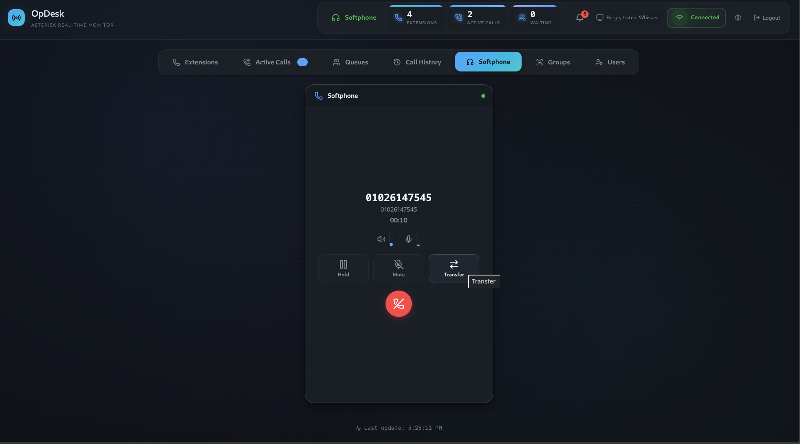
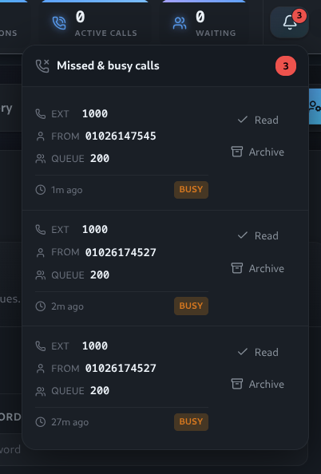
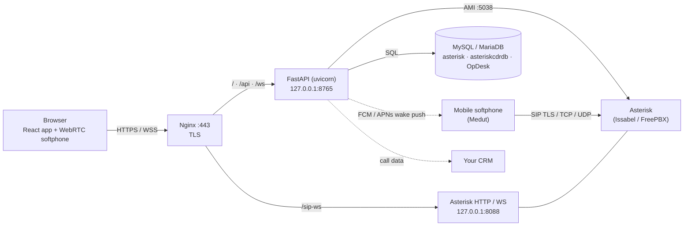

# OpDesk — Operator Panel for Asterisk

A real-time operator panel for **Asterisk PBX** (Issabel / FreePBX), like **FOP2** but built on React and FastAPI. Monitor extensions and queues, manage live calls, browse CDR and recordings, take calls in the browser, and analyse call-center performance, all in one web app.

[](https://www.python.org/)
[](https://nodejs.org/)
[](https://reactjs.org/)
[](https://www.debian.org/)
[](LICENSE)

[Features](#features) • [Screenshots](#screenshots) • [Prerequisites](#prerequisites) • [Install](#install) • [Architecture](#architecture) • [Tech stack](#tech-stack) • [Documentation](#documentation) • [Community](#community--support)

[](screenshots/extensions_dashboard.png)

---

## Features

**Live operations**
- **Real-time panel**: extension status, active calls, queues and call notifications pushed over a WebSocket, with no polling.
- **Dashboard**: active, waiting and ringing calls, longest wait, agent availability and today's KPIs.
- **Supervision**: listen, whisper and barge, allowed per user.
- **Three roles**: **Admin** (everything), **Supervisor** (their assigned agents and queues), **Agent** (their own calls).

**Calling**
- **Web softphone**: make and take calls in the browser over WebRTC, with hold, mute, transfer, queue login/logout, and Ready / Not Ready with a reason code.
- **Mobile softphone**: sign a phone in by scanning a QR code, and wake a closed app for incoming calls with **RFC 8599** push (FCM / APNs VoIP). Recommended app: [Medut Softphone](https://github.com/Ibrahimgamal99/medut-softphone). → [guide](docs/guides/mobile-push.md)
- **Recording**: full-call and per-leg recordings, with automatic talk/silence analysis (Silero VAD).

**History and analytics**
- **Call log**: whole-history search, recording playback, QoS, and a **Call Journey** timeline for multi-leg calls.
- **Analytics**: 12 KPIs with period-over-period change, per-queue and per-agent breakdowns, a 7×24 heatmap, and drill-down with CSV/XLSX export. → [guide](docs/guides/analytics.md)
- **Contacts**: a shared phonebook that puts names on numbers everywhere, filled by hand or from your CRM. → [contract](docs/api/contact-lookup.md)

**Integration**
- **CRM push**: send call data to any CRM (API key, Basic, Bearer or OAuth2) with your own field names and outcome values. Every delivery is logged and can be resent. → [contract](docs/api/webhooks.md)
- **REST API**: scoped API keys for live state, call history and analytics, plus click-to-call. → [reference](docs/api/endpoints.md)
- **Logs**: a live AMI event console, SIP trace and CRM delivery log for debugging.

**Interface**: English, Arabic (RTL), Spanish, Portuguese and Ukrainian; light and dark themes; works on phones.

---

## Screenshots

| Dashboard | Active calls | Queues |
|---|---|---|
| [](screenshots/extensions_dashboard.png) | [](screenshots/active_calls.png) | [](screenshots/queue.png) |

| Call log | Call Journey | QoS |
|---|---|---|
| [](screenshots/call_history.png) | [](screenshots/call_journey.png) | [](screenshots/qos.png) |

| Softphone | Softphone (in call) | Notifications |
|---|---|---|
| [](screenshots/softphone.png) | [](screenshots/softphone_incall.png) | [](screenshots/notfication.png) |

---

## Prerequisites

- **Issabel or FreePBX** with Asterisk, **AMI** enabled, and the Asterisk HTTP server on port 8088 (the installer checks it).
- **MySQL / MariaDB**: the PBX's own database server.
- **Debian 12+, Ubuntu or a RHEL family OS**, with `sudo` and `curl`. The installer adds Python 3.11+, Node.js, Nginx and the other tools it needs.
- **For a public install**: a DNS name pointing at the server, with port 80 open for Let's Encrypt.

> **Port 443 is usually taken.** FreePBX and Issabel run Apache on 80 and 443. The installer
> detects this and offers to serve OpDesk on another port (default `8443`) or to move Apache
> to `4443`. See [Ports](docs/guides/installation.md#ports).

---

## Install

**Native (recommended)**: run on the PBX server.

```bash
curl -k -O https://raw.githubusercontent.com/Ibrahimgamal99/OpDesk/main/install.sh
chmod +x install.sh

sudo ./install.sh                                                                  # LAN, self-signed certificate
sudo OPDESK_DOMAIN=opdesk.example.com OPDESK_LE_EMAIL=admin@example.com ./install.sh   # public, Let's Encrypt
```

The installer clones to `/opt/OpDesk`, sets up the database, AMI user, Nginx, certificate and the `opdesk` systemd service.

Then:

1. Open **`https://<server>`** (add `:8443` or whichever port you chose if it isn't 443).
2. Sign in as **`admin`** with the password the installer printed, and change it from the profile menu.
3. Under **Users**, link users to their extensions so they get a softphone.

**To update**, re-run `sudo ./install.sh` from `/opt/OpDesk`. Your settings and port are kept.

**Docker**:

```bash
git clone https://github.com/Ibrahimgamal99/OpDesk.git && cd OpDesk
cp .env.example .env && nano .env
docker compose up --build -d
```

The container uses host networking and serves HTTP on `127.0.0.1:8765`. Put Nginx with [`nginx/opdesk.conf`](nginx/opdesk.conf) in front of it for TLS.

→ Full details, service commands and troubleshooting: **[Installation guide](docs/guides/installation.md)** · Settings and `.env`: **[Configuration guide](docs/guides/configuration.md)**

---

## Architecture



| Component | Role |
|---|---|
| **React frontend** | The panel. Live state arrives over the `/ws` WebSocket; history and settings use the REST API. The softphone registers to Asterisk through `/sip-ws`. |
| **FastAPI backend** | Keeps one AMI connection, turns Asterisk events into presence, queue and call events, and sends each user the part their role may see. Serves the REST API and pushes call data to your CRM. |
| **Asterisk** | Still owns the dialplan. OpDesk uses AMI for monitoring and call control (originate, transfer, listen / whisper / barge). |
| **Nginx** | Terminates TLS (the browser needs HTTPS for the microphone) and proxies to the backend and to Asterisk. |
| **Database** | Reads FreePBX's `asterisk` config and `asteriskcdrdb` CDR. Its own database holds users, groups, contacts, settings, API keys, the CRM delivery log and analytics rollups. Call history is read from the CDR, not copied. |

---

## Tech stack

| Layer | Technologies |
|---|---|
| **Backend** | Python 3.11+, FastAPI, uvicorn, asyncio, WebSockets, MySQL/MariaDB, PyJWT + bcrypt, httpx (CRM push), openpyxl (XLSX export), onnxruntime (Silero VAD) |
| **Frontend** | React 18, TypeScript, Vite, SIP.js (WebRTC), Recharts, Framer Motion, Lucide icons, react-i18next |
| **Telephony** | Asterisk AMI, Asterisk HTTP/WebSocket (SIP over WSS), RFC 8599 push via FCM and APNs, VAPID Web Push |
| **Deployment** | Nginx, systemd, Let's Encrypt; or Docker Compose |

---

## Documentation

| Guide | What it covers |
|---|---|
| [Installation](docs/guides/installation.md) | Prerequisites, ports, native and Docker installs, running, updating, troubleshooting. |
| [Configuration](docs/guides/configuration.md) | `backend/.env`, the Settings page, roles and groups, debugging. |
| [Mobile softphone](docs/guides/mobile-push.md) | QR sign-in, RFC 8599 wake-up, Firebase and APNs setup. |
| [Analytics](docs/guides/analytics.md) | Every KPI, how it is computed, and how to tune it. |
| [API overview](docs/api/overview.md) · [Endpoints](docs/api/endpoints.md) | Authentication, API keys and scopes, and every endpoint. |
| [CRM push](docs/api/webhooks.md) · [Contact lookup](docs/api/contact-lookup.md) | The outgoing call-data push and the incoming contact lookup. |

The full index is in [docs/](docs/README.md). A running server also serves interactive API docs at `/docs` and `/redoc`, and the OpenAPI spec at `/api/openapi.yaml`.

---

## Community & support

- **Questions and discussion**: [Telegram group](https://t.me/+i1OVDDPgGLo0MGZh) · mailing list [opdesk-dev@googlegroups.com](mailto:opdesk-dev@googlegroups.com)
- **Bugs and feature requests**: [GitHub Issues](https://github.com/Ibrahimgamal99/OpDesk/issues). Include your PBX (Issabel / FreePBX and version) and the output of `sudo journalctl -u opdesk -n 200`.
- **Contributing**: pull requests are welcome. Open an issue first for larger changes.
- **Author**: [Ibrahim Gamal](https://github.com/Ibrahimgamal99) · [LinkedIn](https://www.linkedin.com/in/ibrahim-gamal99) · ib.gamal.a@gmail.com

If OpDesk is useful to you, star the repo. OpDesk is licensed under the **[GNU GPL v3](LICENSE)**: you may use, modify and redistribute it, and anything you distribute that is based on it must be released under GPL v3 with its source. It is developed by Ibrahim Gamal, with AI-assisted tooling for boilerplate and acceleration.
