# OpDesk — Operator Panel for Asterisk

A real-time operator panel for **Asterisk PBX** (Issabel 5 / FreePBX 16 and 17), like **FOP2** but built on React and NestJS. Monitor extensions and queues, manage live calls, browse CDR and recordings, take calls in the browser, and analyse call-center performance, all in one web app.

[](https://nodejs.org/)
[](https://nestjs.com/)
[](https://reactjs.org/)
[](docs/guides/installation.md#supported-systems)
[](LICENSE)

[Features](#features) • [Screenshots](#screenshots) • [Prerequisites](#prerequisites) • [Install](#install) • [Architecture](#architecture) • [Tech stack](#tech-stack) • [Documentation](#documentation) • [Community](#community--support)

[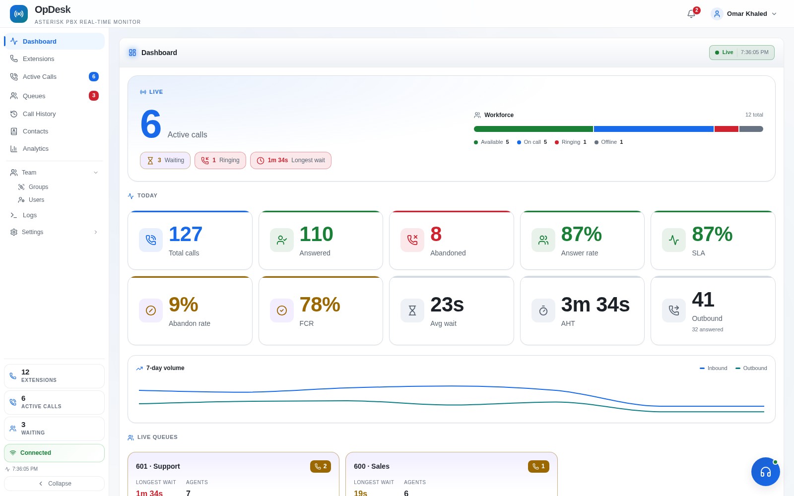](screenshots/dashboard.png)

---

## Features

**Live operations**
- **Real-time panel**: extension status, active calls, queues and call notifications pushed over a WebSocket, with no polling.
- **Dashboard**: active, waiting and ringing calls, longest wait, agent availability and today's KPIs.
- **Supervision**: listen, whisper and barge, allowed per user.
- **Three roles**: **Admin** (everything), **Supervisor** (their assigned agents and queues), **Agent** (their own call history; live view of their groups).
- **Not-Ready codes**: agents pause with a reason. The reason is kept across device changes, wrap-up time is applied after calls, and adherence is reported per agent with a timeline.

**Calling**
- **Web softphone**: make and take calls in the browser over WebRTC, with hold, mute, transfer, queue login/logout, and Ready / Not Ready with a reason code.
- **Mobile softphone**: sign a phone in by scanning a QR code, and wake a closed app for incoming calls with **RFC 8599** push (FCM / APNs VoIP). Recommended app: [Medut Softphone](https://github.com/Ibrahimgamal99/medut-softphone). → [guide](docs/guides/mobile-push.md)
- **Recording**: full-call and per-leg recordings, with recording policy per direction and extension, retention, storage stats, and automatic talk/silence analysis (Silero VAD).

**History and analytics**
- **Call log**: whole-history search with one 10-value call status (Answered, Unanswered, Busy, Missed, Voicemail, Unreachable, Failure, Network error, Abandoned, Dropped), who ended the call, recording playback, QoS, CSV export, and a **Call Journey** timeline for multi-leg calls (IVR steps, transfers, listen / whisper / barge).
- **Analytics**: KPIs with period-over-period change, per-queue and per-agent breakdowns with compare charts, a 7×24 heatmap, agent adherence, and CSV export of every tab (plus XLSX for the drill-down). → [guide](docs/guides/analytics.md)
- **Contacts**: a shared phonebook that puts names on numbers everywhere, filled by hand or from your CRM. → [contract](docs/api/contact-lookup.md)

**Integration**
- **CRM push**: send call data to any CRM (API key, Basic, Bearer or OAuth2) with your own field names and outcome values. Every delivery is logged and can be resent. → [contract](docs/api/webhooks.md)
- **REST API**: scoped API keys for live state, call history and analytics, plus click-to-call and softphone account lookup. → [reference](docs/api/endpoints.md)
- **Logs**: a live AMI event console, SIP trace, CRM delivery log, and an **audit log** of every change made through the UI or API.

**Interface**: English, Arabic (RTL), Spanish, Portuguese and Ukrainian; light and dark themes; works on phones.

---

## Screenshots

*Shown with demo data.*

| Extensions | Active calls | Queues |
|---|---|---|
| [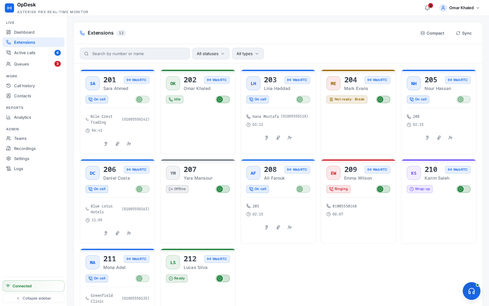](screenshots/extensions.png) | [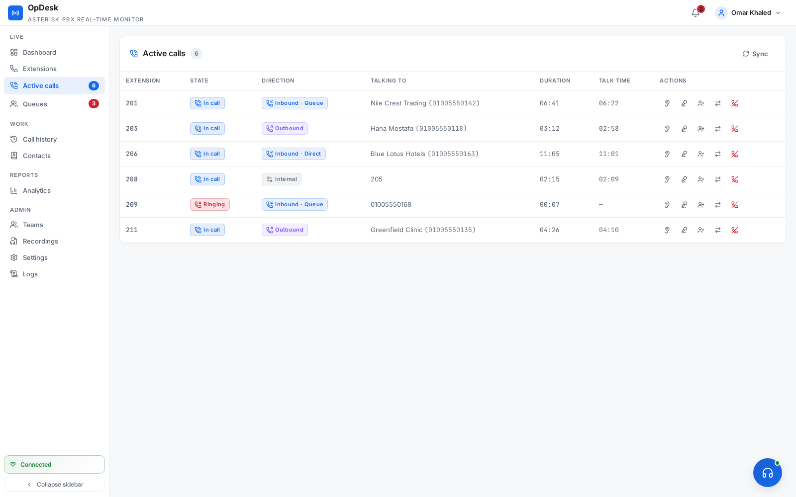](screenshots/active_calls.png) | [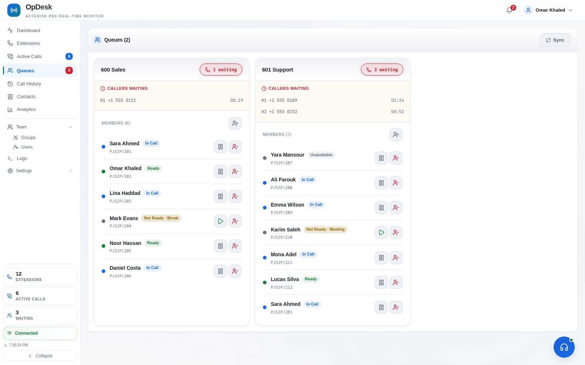](screenshots/queues.png) |

| Agent board | Call log | Call Journey |
|---|---|---|
| [](screenshots/agent_board.png) | [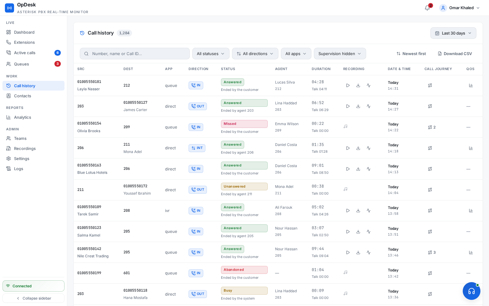](screenshots/call_log.png) | [](screenshots/call_journey.png) |

| Recordings | Contacts | Dark theme |
|---|---|---|
| [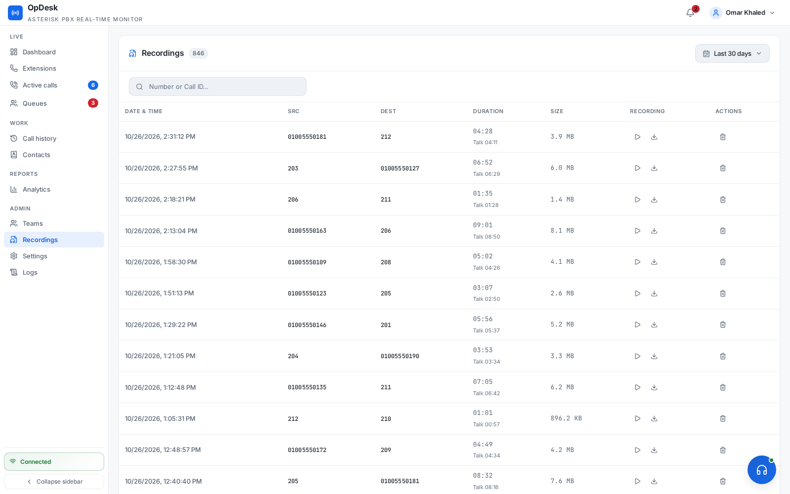](screenshots/recordings.png) | [](screenshots/contacts.png) | [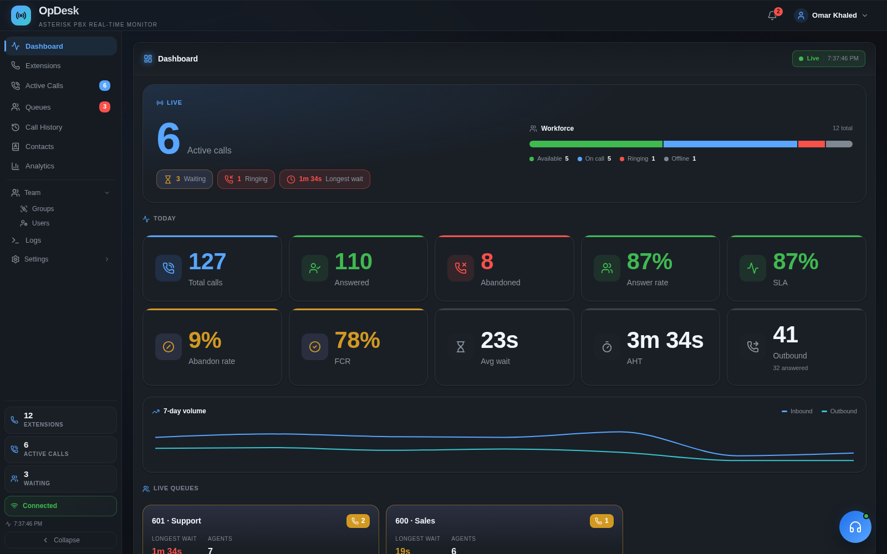](screenshots/dashboard_dark.png) |

| Analytics | Queue performance | Agent performance |
|---|---|---|
| [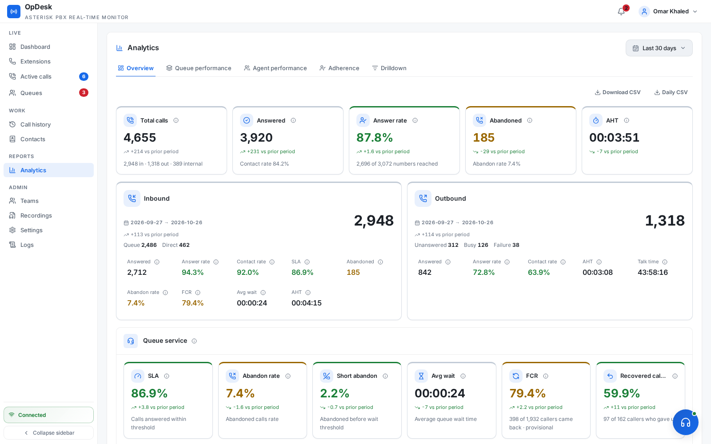](screenshots/analytics.png) | [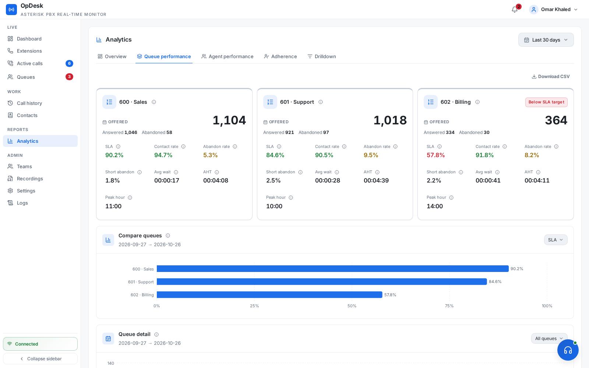](screenshots/analytics_queues.png) | [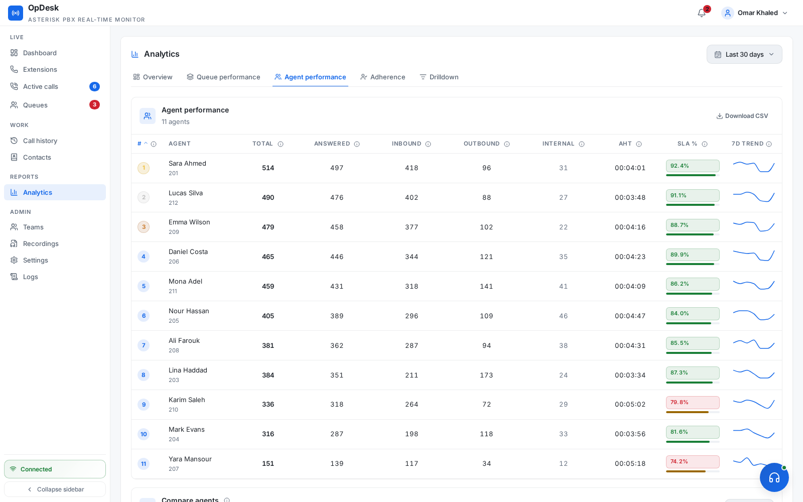](screenshots/analytics_agents.png) |

| Softphone | Incoming call | Mobile app QR |
|---|---|---|
| [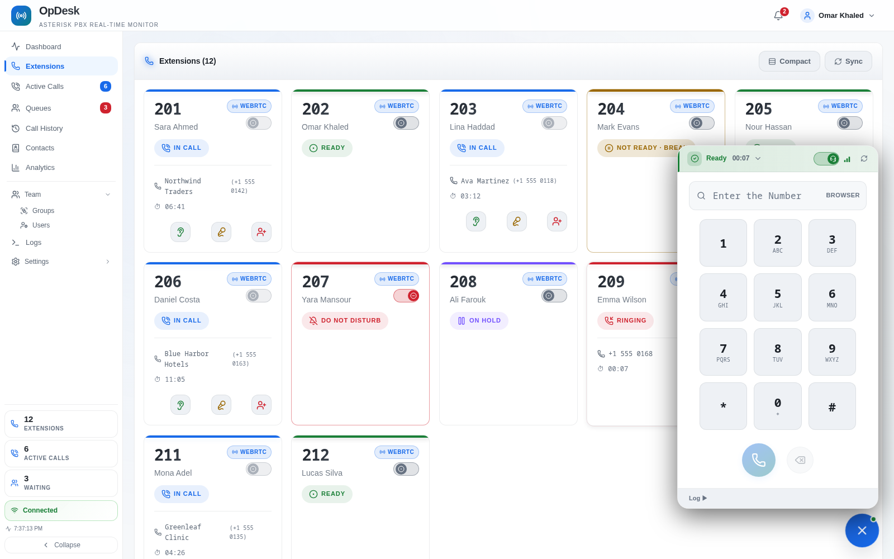](screenshots/softphone.png) | [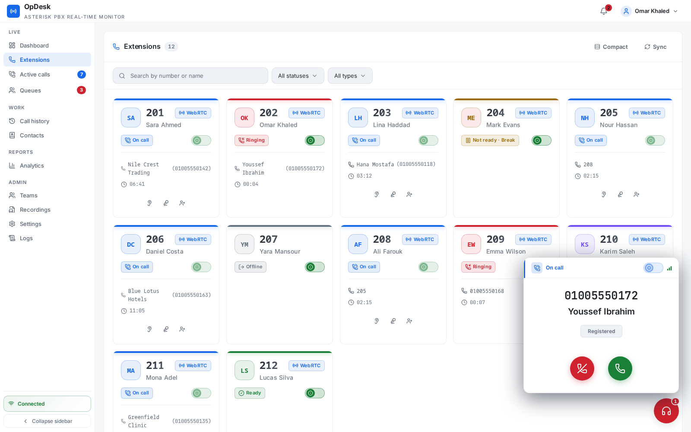](screenshots/softphone_ringing.png) | [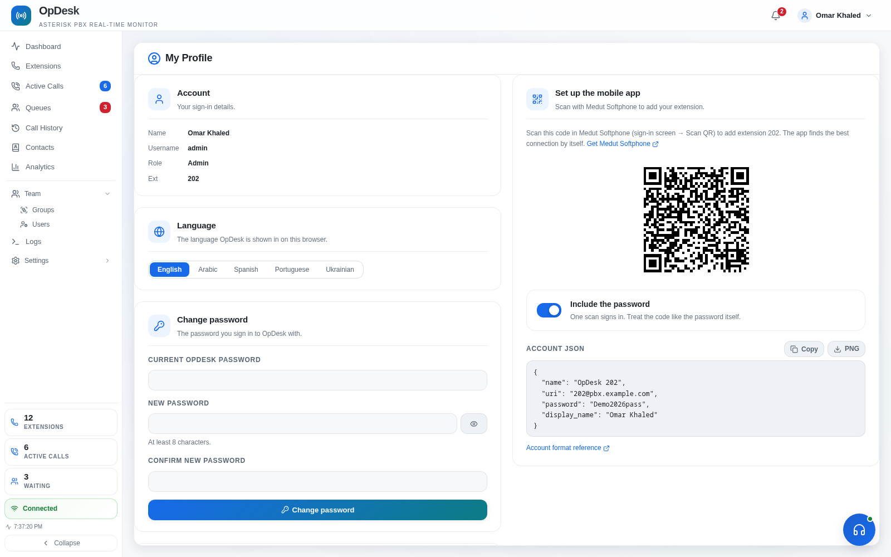](screenshots/mobile_qr.png) |

| Mobile Wake settings |   |   |
|---|---|---|
| [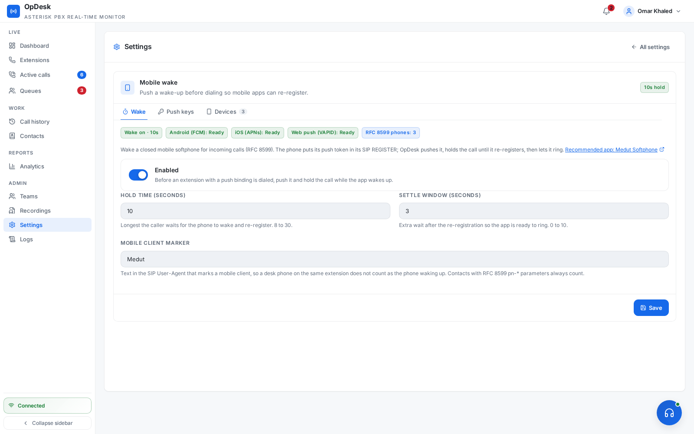](screenshots/mobile_wake.png) |   |   |

---

## Prerequisites

- **Issabel 5** (Rocky Linux 8) or **FreePBX 16 / 17** (Debian 12, Debian 10/11, Rocky/Alma 8), or plain Asterisk, with **AMI** enabled and the Asterisk HTTP server on port 8088 (the installer checks it).
- **MySQL / MariaDB**: the PBX's own database server.
- **glibc 2.28 or newer** for Node.js 24. FreePBX 16 on Sangoma Linux 7 / CentOS 7 (glibc 2.17) runs OpDesk through [Docker](docs/guides/installation.md#option-b-docker) instead.
- **Root** (`sudo`) and `curl`. The installer adds Node.js 24 (nvm), nginx, a small Python venv for voice-activity analysis, and the other tools it needs.
- **For a public install**: a DNS name pointing at the server, with port 80 reachable for Let's Encrypt.

> **Port 443 is usually taken.** The PBX's Apache serves its own web UI:
> - **Issabel 5**: Apache keeps 80 and 443, and the installer never moves it. OpDesk is served on **`8443`**, and Let's Encrypt validates through Apache's web root.
> - **FreePBX 16 / 17**: Apache holds 80, and 443 too once HTTPS is set up there. OpDesk then defaults to **`8443`**. The installer can instead move Apache from 443 to `4443`.
>
> See [Ports](docs/guides/installation.md#ports).

---

## Install

**Native (recommended)**: run on the PBX server.

```bash
curl -fsSLO https://raw.githubusercontent.com/Ibrahimgamal99/OpDesk/main/install.sh
chmod +x install.sh

sudo ./install.sh                                                                  # LAN, self-signed certificate
sudo OPDESK_DOMAIN=opdesk.example.com OPDESK_LE_EMAIL=admin@example.com ./install.sh   # public, Let's Encrypt
```

The installer clones to `/opt/OpDesk`. It sets up Node.js 24, the database user and schema, the AMI user, nginx, the certificate and the `opdesk` systemd service, then builds and starts OpDesk. Add `--yes` for an unattended run.

Then:

1. Open **`https://<server>`** (add `:8443` or whichever port you chose if it isn't 443).
2. Sign in as **`admin`** with the password you entered, or the default `OpDesk@2026` if you pressed Enter. Change it from the profile menu.
3. Under **Users**, link users to their extensions so they get a softphone.

**To update**, re-run `sudo ./install.sh` from `/opt/OpDesk`. Your settings and port are kept. **To uninstall**, run `sudo ./install.sh --uninstall` ([what it removes](docs/guides/installation.md#uninstalling)). Upgrading from the Python backend (1.x)? See [the upgrade notes](docs/guides/installation.md#upgrading-from-the-python-backend-opdesk-1x).

**Docker**:

```bash
git clone https://github.com/Ibrahimgamal99/OpDesk.git && cd OpDesk
cp .env.example .env && nano .env
docker compose up --build -d
```

The container uses host networking and serves HTTP on `127.0.0.1:8765`. Put nginx in front of it for TLS, using [`nginx/opdesk.conf.example`](nginx/opdesk.conf.example). The database user, schema and AMI user are created on the host: see [Docker](docs/guides/installation.md#option-b-docker).

→ Full details, service commands and troubleshooting: **[Installation guide](docs/guides/installation.md)** · Settings and `.env`: **[Configuration guide](docs/guides/configuration.md)**

---

## Architecture

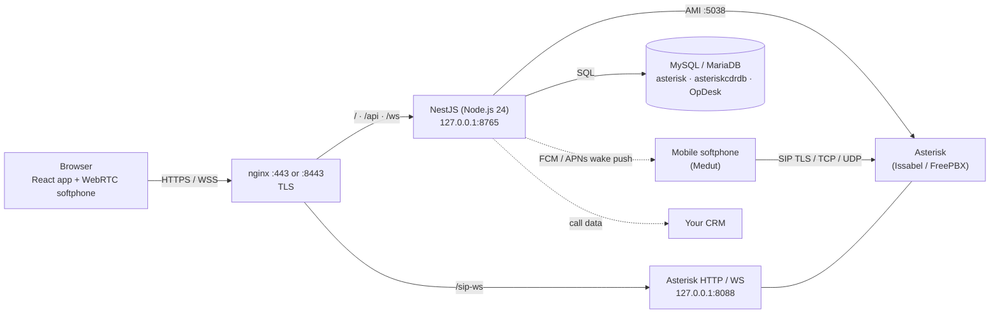

| Component | Role |
|---|---|
| **React frontend** | The panel. Live state arrives over the `/ws` WebSocket; history and settings use the REST API. The softphone registers to Asterisk through `/sip-ws`. |
| **NestJS backend** | Node.js 24, TypeScript. Keeps one AMI connection, turns Asterisk events into presence, queue and call events, and sends each user the part their role may see. Serves the REST API and the built frontend, and pushes call data to your CRM. A small Python helper analyses recordings for talk and silence. |
| **Asterisk** | Still owns the dialplan. OpDesk uses AMI for monitoring and call control (originate, transfer, listen / whisper / barge). |
| **nginx** | Terminates TLS (the browser needs HTTPS for the microphone) and proxies to the backend and to Asterisk. |
| **Database** | Reads the PBX's `asterisk` config and `asteriskcdrdb` CDR (FreePBX and Issabel use the same names). Its own database holds users, groups, contacts, settings, API keys, the CRM delivery log and analytics rollups. Call history is read from the CDR, not copied. |

---

## Tech stack

| Layer | Technologies |
|---|---|
| **Backend** | Node.js 24, NestJS 11 (Express 5), TypeScript, `ws` WebSockets, mysql2 (MySQL/MariaDB), bcryptjs + JWT, zod validation, exceljs (XLSX export), web-push; Python venv with onnxruntime + WebRTC VAD for talk/silence analysis |
| **Frontend** | React 18, TypeScript, Vite, SIP.js (WebRTC), Recharts, Framer Motion, Lucide icons, react-i18next |
| **Telephony** | Asterisk AMI, Asterisk HTTP/WebSocket (SIP over WSS), RFC 8599 push via FCM and APNs, VAPID Web Push |
| **Deployment** | nginx, systemd, Let's Encrypt (Debian, Rocky 8 / Issabel 5); or Docker Compose |

---

## Documentation

| Guide | What it covers |
|---|---|
| [Installation](docs/guides/installation.md) | Supported systems (Issabel 5, FreePBX 16/17), ports and Apache, native and Docker installs, running, updating, troubleshooting. |
| [Configuration](docs/guides/configuration.md) | `backend/.env`, the Settings page, roles and visibility, audit log, debugging. |
| [Mobile softphone](docs/guides/mobile-push.md) | QR sign-in, RFC 8599 wake-up, Firebase and APNs setup. |
| [Analytics](docs/guides/analytics.md) | Every KPI, how it is computed, and how to tune it. |
| [API overview](docs/api/overview.md) · [Endpoints](docs/api/endpoints.md) | Authentication, API keys and scopes, and every endpoint. |
| [CRM push](docs/api/webhooks.md) · [Contact lookup](docs/api/contact-lookup.md) | The outgoing call-data push and the incoming contact lookup. |

The full index is in [docs/](docs/README.md). A running server also serves interactive API docs at `/docs` and `/redoc`, and the OpenAPI spec at `/api/openapi.yaml`.

---

## Community & support

- **Questions and discussion**: [Telegram group](https://t.me/+i1OVDDPgGLo0MGZh) · mailing list [opdesk-dev@googlegroups.com](mailto:opdesk-dev@googlegroups.com)
- **Bugs and feature requests**: [GitHub Issues](https://github.com/Ibrahimgamal99/OpDesk/issues). Include your PBX (Issabel / FreePBX and version) and the output of `sudo journalctl -u opdesk -n 200`.
- **Contributing**: pull requests are welcome. Open an issue first for larger changes.
- **Author**: [Ibrahim Gamal](https://github.com/Ibrahimgamal99) · [LinkedIn](https://www.linkedin.com/in/ibrahim-gamal99) · ib.gamal.a@gmail.com

If OpDesk is useful to you, star the repo. OpDesk is licensed under the **[GNU GPL v3](LICENSE)**: you may use, modify and redistribute it, and anything you distribute that is based on it must be released under GPL v3 with its source. It is developed by Ibrahim Gamal, with AI-assisted tooling for boilerplate and acceleration.
